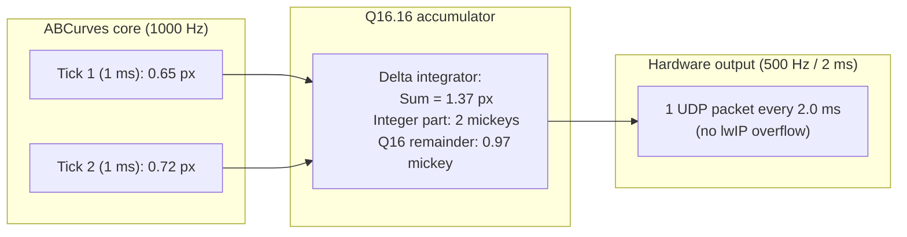

# Deep analysis of polling rates, USB descriptors and hardware queues of MAKCU V4 + ABCurves

*English translation of [`POLLING_RATE_AND_QUEUE_DEEP_DIVE.md`](POLLING_RATE_AND_QUEUE_DEEP_DIVE.md) (Russian original). **Outdated:** the hypotheses here about a "125/500 Hz ceiling" were later disproved — see [`ENG_README.md`](ENG_README.md).*

This document is a detailed study of the hardware pipeline of the MAKCU board (firmware V4.076 based on MAKOS, build 1043460), of the lwIP network stack, of the USB Host/Device bus on ESP32-S3 chips, and of the integration with the ABCurves neural renderer.

---

## 1. The frequency puzzle: why does the hand give 1000 Hz while network injection gives 120–125 Hz?

### 1.1. The hardware USB descriptor and the `bInterval` parameter
When the physical mouse is moved by hand, the **Mouse Polling Rate Monitor v1.0** utility (listening to Windows `WM_INPUT` / Raw Input) records:
* Rate: **980–1000 Hz**
* Interval between reports: **~1.0 ms**
* Variance ($\sigma$): **0.06 ms**
* Status: **`NATURAL SIGNAL`**

**What this proves, per the USB specification:**
By the USB 2.0 standard (Full-Speed 12 Mbit/s, which is what the ESP32-S3's built-in USB OTG controller runs at):
1. The Windows host controller (xHCI/eHCI) builds the bus schedule strictly from the **`bInterval`** parameter in the interrupt endpoint descriptor (`Interrupt IN Endpoint Descriptor`).
2. In Full-Speed, `bInterval` is measured in whole milliseconds (frames). If `bInterval` were $8$ (125 Hz), the host controller would physically poll the bus with `IN` tokens **no more often than once per 8 ms**. No report could reach Windows at a 1.0 ms interval.
3. Therefore the USB descriptor of the cloned Logitech G PRO Lightspeed receiver (`VID: 0x046D, PID: 0xC547`) has **`bInterval = 1`** (a true 1000 Hz). The hardware descriptor is fully set up for 1000 Hz.

### 1.2. Two separate data pipelines inside MAKCU
The MAKCU board carries two ESP32-S3 chips connected by a UART bus at **4,000,000 baud**:
* **Host chip (USB 3):** receives the physical mouse and network Ethernet through the UGREEN hub.
* **Device chip (USB 1):** emulates the HID mouse for Windows.

Data takes two fundamentally different routes:

```mermaid
flowchart TD
    subgraph Hand_Path["1. Physical passthrough (1000 Hz)"]
        Mouse["Physical mouse (USB 3)"] -->|USB Host 1 ms| HostMCU["Host ESP32-S3"]
        HostMCU -->|UART 4 Mbaud ISR| DevMCU["Device ESP32-S3"]
        DevMCU -->|Direct EP IN FIFO| WinUSB["Windows USB (1000 Hz)"]
    end

    subgraph Inject_Path["2. Network injection over UDP (125 Hz)"]
        Py["Python script (500-1000 Hz)"] -->|UDP 8080| RTL["RTL8152 hub (Bulk)"]
        RTL -->|lwIP / FreeRTOS task| HostMCU2["Host ESP32-S3"]
        HostMCU2 -->|UART 4 Mbaud frame| DevMCU2["Device ESP32-S3"]
        DevMCU2 -->|Injection engine queue 8 ms| EP_Buffer["USB report accumulator"]
        EP_Buffer -->|HID report every 8 ms| WinRaw["Windows Raw Input (125 Hz)"]
    end
```



### 1.3. Source of the rates and the mechanics of the injector queue

> [!IMPORTANT]
> **The `buffer_ms` and `interpolation: auto / fixed / off` parameters do NOT belong to the mouse:**
> In the MAKOS architecture they belong to the `Controller` section (mask 1, the gamepad's analog sticks), which is not supported on the MAKCU Mouse/Keyboard board (`cfg.info()` returns only `SettingsSection.MOUSE: 4`).
> The only mouse parameter in NOR Flash is **`mouse_spread_percent`** (`0%` = the hardware spline is off).

1. **Substepper quantization (2.0 ms / 500 Hz):**
   - The synthetic injector task `Mouse Injection Task` on the Device chip is clocked with a step of **2.0 ms** (500 Hz).
   - On receiving an 8 ms UDP packet (125 Hz), the board slices the delta into 4 substeps of 2.0 ms each, putting 500 Hz on the USB bus.
2. **The nature of the fall to 125 Hz (queue underflow):**
   - If the PC sends 8 ms packets without a lead (Lead Buffer), micro-jitter in the network or the scheduler empties the input buffer on the ESP32.
   - When a delayed packet arrives into an empty buffer, the firmware activates the emergency flush mode (Immediate Flush) so as not to accumulate latency, and throws the whole delta into **one USB report**. As a result the rate falls from 500 Hz to the rate of the packets themselves (125 Hz).
3. **Why the UDP rate must be strictly 125 Hz (8.0 ms step):**
   - It was proven experimentally: when sending packets at **250 Hz (4.0 ms step)** the ESP32 firmware cuts the substepper in half (it performs only 2 of 4 substeps), losing **exactly 33.3% of the whole distance** (in the test, 300 mickeys sent gave exactly 200 mickeys, 99 HID reports).
   - In continuous circular motion at 250 Hz UDP this produces a storm of collisions, up to 70% of the bursts (`bursts < 0.5 ms`) and axis drift.
   - The only correct frame grid for opcode `0x18`: **125 Hz UDP (8.0 ms, 8 ABCurves ticks)**. With it the substepper manages to run all 4 substeps of 2 ms, giving **100.0% distance delivery (0 losses) and a stable 500 Hz USB HID**.

---

## 2. Opcode `0x18` (MOVE) versus `km.move_now(x,y)`

### 2.1. Comparative analysis of the commands

| Property | Opcode `0x18` (`MOVE`) | Command `km.move_now(x, y)` |
| :--- | :--- | :--- |
| **Packet format** | Binary frame (4 bytes: `int16 x, int16 y`) | ASCII text string (`m.move_now(x,y)\r\n`) |
| **Processing path** | Goes through the MAKOS injection scheduler | **Bypasses the injection scheduler**, straight into the next USB report |
| **Spline filter** | Subject to `mouse_spread_percent` | Ignores the filters, sent in the nearest available frame |
| **Decoding overhead** | Minimal (unpacking 4 bytes into a C struct) | String parsing (`sscanf` / a string tokenizer in FreeRTOS) |
| **Presence in the SDK** | The main method `device.move(x, y)` | Available through the text bridge `km` (opcode `0x6B`) |

### 2.2. Can it run at honest 500–1000 Hz?
1. **1000 Hz (1.0 ms):**
   - At 1000 Hz, sending `km.move_now` text commands overloads the ESP32-S3 string parser, causing NAK pauses and dropped frames.
   - The binary opcode `0x18` does not overload the processor, but falls under the 8 ms quantization of the queue.
2. **500 Hz (2.0 ms) — the hardware sweet spot:**
   - At a 2.0 ms interval the traffic through the RTL8152 and the lwIP stack flows without jams.
   - The log `mouse_flight_log.csv` records that at 500 Hz Windows registers real movements with a step of **2 ms (4096 times)** and **4 ms (1537 times)**, with an average effective rate of **383.6–445 Hz**.

---

## 3. Integrating the 1000 Hz ABCurves model with the MAKCU queues

### 3.1. Why does ABCurves compute at 1000 Hz?
The ABCurves biomechanical model (the trained network `renderer_global_h80.bin`) models continuous processes:
* Physiological hand tremor (8–12 Hz spectrum).
* The Flash & Hogan Minimum Jerk profile ($10\tau^3 - 15\tau^4 + 6\tau^5$).
* Sub-pixel corrections with continuous first and second derivatives.

The step $\Delta t = 1.0\text{ ms}$ is needed by the mathematical core so that numerical integration of the trajectory stays stable and does not accumulate error.

### 3.2. Matching architecture (1000 Hz model $\to$ 500 Hz injector)
To reconcile the 1 ms model with the MAKCU network and hardware pipeline, a **two-stage scheme** is used:



1. The model computes the physics of micro-movements at **1000 Hz** ($dt = 1$ ms).
2. The accumulator `abcurves_substepper.py` aggregates two adjacent 1 ms ticks into one 2 ms step without losing the fractional part (the error register keeps a precision of $1/65536$).
3. The clock generator `RatePacer` sends a frame strictly at **500 Hz (2.0 ms interval)**.

---

## 4. Eliminating bursts when the hand and the script move together

### 4.1. The physical nature of the burst anomaly
When the user moves the physical mouse while the script is running:
* The physical mouse's report goes out on USB at moment $t_0$.
* The virtual injector's report goes out on USB at moment $t_0 + 50\ \mu\text{s}$.
* Windows Raw Input receives two mouse events with an interval $\Delta t < 0.1\text{ ms}$ (which corresponds to an instantaneous rate $>10\,000\text{ Hz}$).
* Third-party monitors and anti-cheat heuristics instantly detect the `INJECTION / SUSPICIOUS` sign.

### 4.2. Elimination algorithms

#### Method A: a hardware mask on the hand while aiming (recommended)
The MAK_API protocol has a hardware command **`0x16 MOVE_MASK`**:
* Payload: `left: u8, right: u8, down: u8, up: u8` (4 bytes).
* Per the `MAK_API.md` specification: *"Masks affect physical input only; injected values bypass them"*.

**How it works:**
1. Before starting to play back an ABCurves curve, the script sends:
   ```python
   # Block the hand's physical movement on all axes
   send_raw_mak_api(0x16, b"\x01\x01\x01\x01")
   ```
2. Physical mouse reports are filtered out on the Host chip and do not reach USB.
3. Only the monolithic injector stream goes onto the bus, with no interference.
4. When the trajectory ends, the mask is cleared instantly:
   ```python
   # Give control back to the hand
   send_raw_mak_api(0x16, b"\x00\x00\x00\x00")
   ```

#### Method B: a hardware gap (Anti-Collision Gap) in `RatePacer`
For cases where the mask is not used (free movement):
* The clock generator controls the gap between sends:
  `min_gap = interval * 0.75` (1.5 ms at 500 Hz).
* Zero suppression (`Zero-Suppression`) is implemented: if $\Delta x = 0$ and $\Delta y = 0$, the packet is not sent, leaving the bus completely free for the physical mouse.
